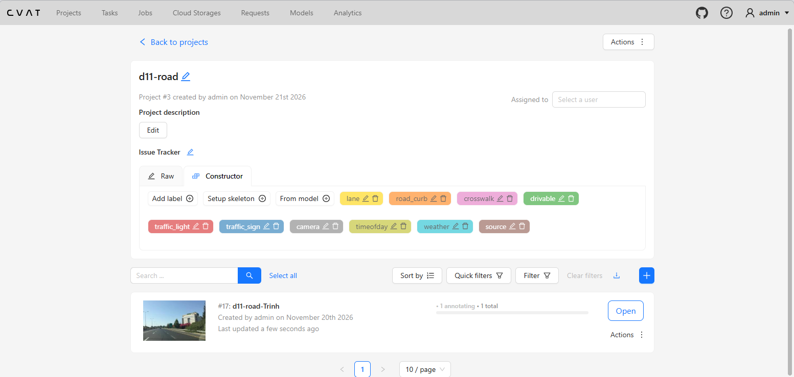
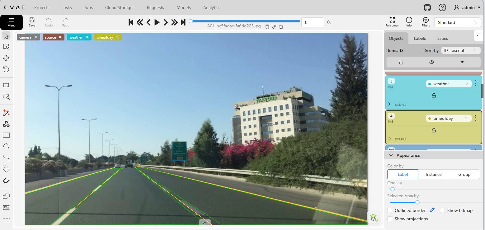
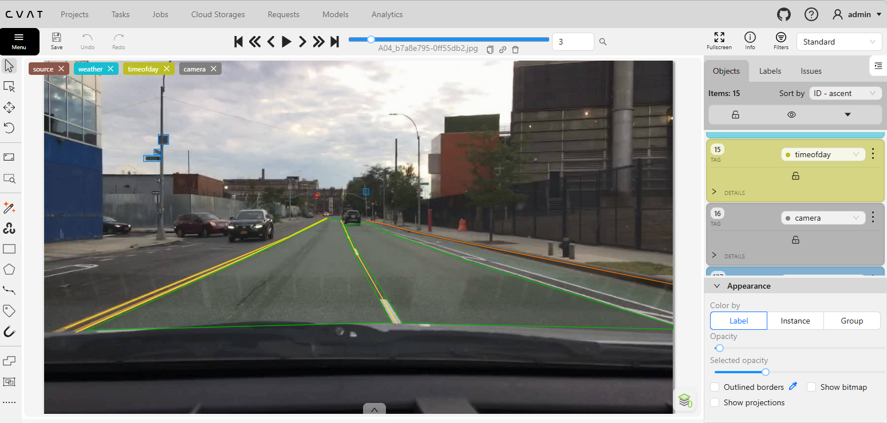
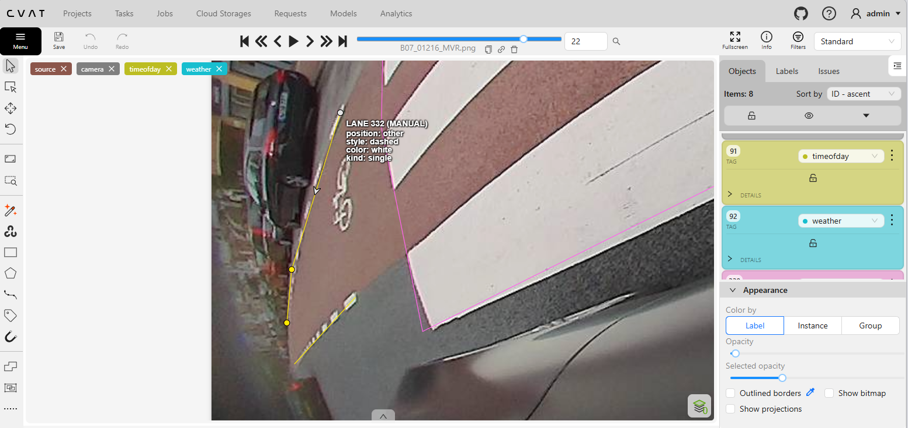
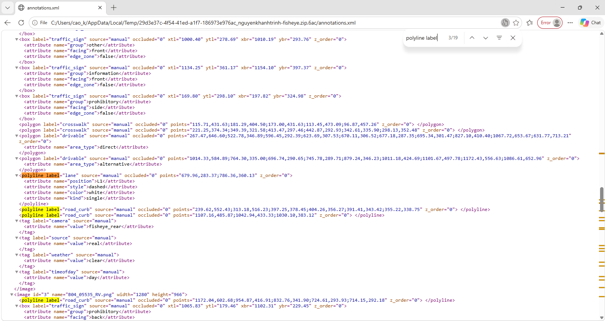

# Báo cáo cá nhân — Ngày 11
Họ tên: Nguyễn Khánh Trình    Mã học viên: 2A202603026  
Phiên bản CVAT (Help → About): 2.82.1  
Guideline: Road v1.0    Lần nộp (`revision` trong manifest): 1  
Thời điểm export (ngày giờ trên CVAT): 2026-11-20 khoảng 21:42    Số lần nộp lại sau Rework: 0  

## 1. Kiểm project
| Mục | Đúng như guideline Road v1.0? | Ghi chú |
| --- | --- | --- |
| 6 label, đúng kiểu | Có | lane, road_curb: polyline; crosswalk, drivable: polygon; traffic_light, traffic_sign: rectangle |
| Thuộc tính và giá trị | Có | Đối chiếu phần meta của file export với `configs/road_v1_labels.json`: khớp hết, không thừa, không thiếu |
| 4 tag ảnh | Có | camera, timeofday, weather, source, mỗi tag có thuộc tính select `value` |
Cách kết thúc polyline trên bản CVAT này: click các điểm từ gần xe ra xa, bấm phím **N** để kết thúc  
Cách đặt tag ảnh trên bản CVAT này: công cụ Tag ở thanh bên trái, đặt camera trước rồi timeofday, weather, source; mở Details trong bảng Objects để sửa `value` (CVAT tự điền giá trị đầu danh sách)  

## 2. Số lượng đã gán
| Task | Ảnh | lane | road_curb | crosswalk | drivable | traffic_light | traffic_sign |
| --- | ---: | ---: | ---: | ---: | ---: | ---: | ---: |
| front | 12 | 34 | 13 | 4 | 22 | 25 | 25 |
| front-extra (đã làm 4 / 4) | 4 | 12 | 2 | 5 | 10 | 14 | 13 |
| fisheye | 8 | 6 | 9 | 12 | 8 | 7 | 5 |
| fisheye-extra (đã làm 4 / 4) | 4 | 0 | 4 | 5 | 3 | 0 | 0 |

## 3. Bảng ca khó
| Ảnh | Nhãn | Phân vân giữa | Đã chọn | Lý do |
| --- | --- | --- | --- | --- |
| A05 | lane L1/R1 | vẽ L1/R1 theo mép đường hay bỏ trống | không vẽ lane; mép đường gán `road_curb` | đường không sơn vạch; coach đã xác nhận, được miễn QC1-02 |
| A06 | lane R1 | vẽ R1 hay bỏ trống | không vẽ R1 | bên phải không có vạch sơn; coach đã xác nhận, được miễn QC1-02 |
| A14 | lane R1 | vẽ R1 hay bỏ trống | không vẽ R1 | bên phải không có vạch sơn; coach đã xác nhận, được miễn QC1-02 |
| A14 | lane L1 (vạch vàng đôi) | 1 polyline kind=double (guideline) hay 2 polyline L1 | 2 polyline L1 | coach hướng dẫn và đã xác nhận; lint báo QC1-05 (2 polyline cùng L1) |
| A09 | lane L2 (vạch trắng liền đôi) | 1 polyline kind=double hay 2 polyline L2 | 2 polyline L2, kind=double | làm giống A14 theo hướng dẫn của coach; giảng viên đã cho phép, Phúc miễn QC1-05 trong phiếu cập nhật |

## 4. Phiếu QC 1 nhận được
Bạn kiểm lô của tôi: Nguyễn Thiên Phúc    Quyết định nhận được: **Release** (0 nặng, 3 chính / 72 nhãn = 4,17 %, 1 nhẹ; mẫu A01, A02, A04, A09, B01, B08)  
| Mã lỗi | Số lỗi | Đồng ý? | Đã sửa? |
| --- | ---: | --- | --- |
| QC1-11 (B01 road_curb #5, #6; B08 lane #4: fisheye chỉ 2–3 điểm, chưa theo cung) | 3 | Đồng ý | Chưa: lô đã Release; sẽ thêm điểm theo cung nếu còn thời gian buffer |
| QC1-08 nhẹ (A04 traffic_light #3 thấp hơn 8 px) | 1 | Đồng ý | Không cần sửa: box dưới 8 px không bắt buộc |

Nhận xét: bản đầu của phiếu tính thêm 2 lỗi QC1-05 ở A04 (vạch vàng đôi, 2 polyline L1) và A09 (vạch trắng liền đôi, 2 polyline L2) → Rework 6,94 %. Tôi phản hồi đây là vạch đôi vẽ theo hướng dẫn của coach; giảng viên đã cho phép trên lớp nên Phúc cập nhật phiếu, miễn 2 lỗi này → Release. Ca A06 (thiếu R1) được miễn, khớp với xác nhận của coach.

## 5. Kiểm file export
| File | Mở lại được? | Số shape ảnh 1 (job / file) | Số shape ảnh 2 (job / file) | Tag camera có trong XML? |
| --- | --- | --- | --- | --- |
| nguyenkhanhtrinh-front.zip | có (16 ảnh) | A01: 8 / 8 | A02: 7 / 7 | có, đủ mọi ảnh |
| nguyenkhanhtrinh-fisheye.zip | có (12 ảnh) | B01: 7 / 7 | B02: 6 / 6 | có, đủ mọi ảnh |

## 6. Ảnh chụp màn hình
1. Tab Labels của project.  
   Project `d11-road` (Constructor): 6 label vẽ + 4 tag ảnh:  
   
2. Một ảnh camera trước đã gán đủ (làn, vùng lái, đèn/biển).  
   A01 (frame 0, Items: 12 = 8 shape + 4 tag):  
     
   A04 (frame 3, Items: 15 = 11 shape + 4 tag): vạch vàng đôi L1, R1 đứt, drivable direct/alternative, đèn và biển:  
   
3. Một ảnh fisheye đã gán, phóng to đoạn polyline cong.  
   B07 `fisheye_right` (frame 22, Items: 8 = 4 shape + 4 tag), phóng to lane `position = other`, `dashed`, `white`, `single`:  
   
4. Một đoạn XML có <polyline label="lane">.  
   `annotations.xml` trong `nguyenkhanhtrinh-fisheye.zip` (ảnh B03, `camera = fisheye_rear`):  
   

## 7. Tự đánh giá
Lỗi bạn mắc nhiều nhất hôm nay (theo mã QC1-xx), và cách tránh ở Ngày 20:  
QC1-11 (fisheye): lane và road_curb chỉ đặt 2–3 điểm nên thành đoạn thẳng, và chưa bật `edge_zone` cho đèn/biển gần mép vòng ảnh (B01–B09). Lần đầu export còn QC1-01: A03, A07, A10 thiếu cả 4 tag. Cách tránh ở Ngày 20: đặt tag camera ngay khi mở ảnh; trên fisheye đặt điểm dày theo cung ở vòng ngoài; chạy `road_check lint` sau mỗi lần export và sửa hết dòng nặng trước khi nộp.  
Nhãn của bạn đi vào model ở đâu? Chọn một lỗi đã sửa và nói nó làm model học sai thế nào:  
Nhãn lane thành đích huấn luyện cho model phát hiện làn (row-anchor/polyline), tag camera dùng để chia dữ liệu và chọn mô hình/hiệu chỉnh theo từng camera. Lỗi đã sửa: lane ở B07, B08 (camera bên phải) từng gán R1 thay vì `other`. Nếu giữ nguyên, model sẽ học rằng vạch nhìn từ camera hông là làn sát bên phải xe, làm sai vị trí làn đưa vào LKA/hợp nhất surround view và có thể kích hoạt cảnh báo lệch làn sai.  

## 8. (Tùy chọn, buffer) Từ polyline đến đích row-anchor
| y | 720 | 680 | 640 | 600 | 560 |
| --- | ---: | ---: | ---: | ---: | ---: |
| x của chúng tôi |  |  |  |  |  |
| x của bạn kia |  |  |  |  |  |

Trả lời 3 câu:

1. Năm số x đó chính là đích mà một model row-anchor học cho vạch này. Nếu bạn dừng polyline sớm 40 px, hàng nào đổi thành "không có làn"?
2. So với bạn được kiểm (cùng ảnh): ở hàng 720 và hàng 560, hai bạn lệch nhau bao nhiêu pixel? Lệch ở hàng nào ảnh hưởng LKA nhiều hơn (slide 25)?
3. Nếu polyline vẽ từ xa về gần (ngược quy tắc 2), cách tính trên có đổi không? Script nào sẽ gặp khó?
